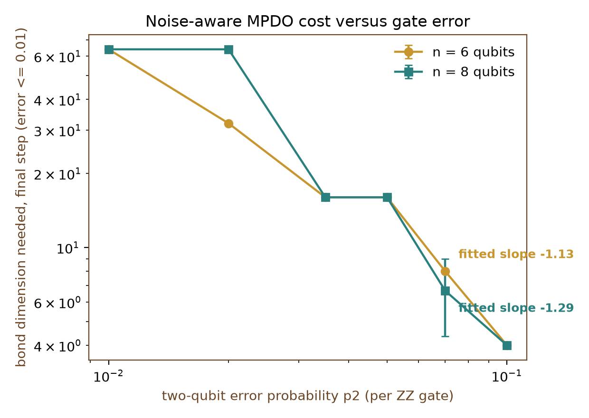
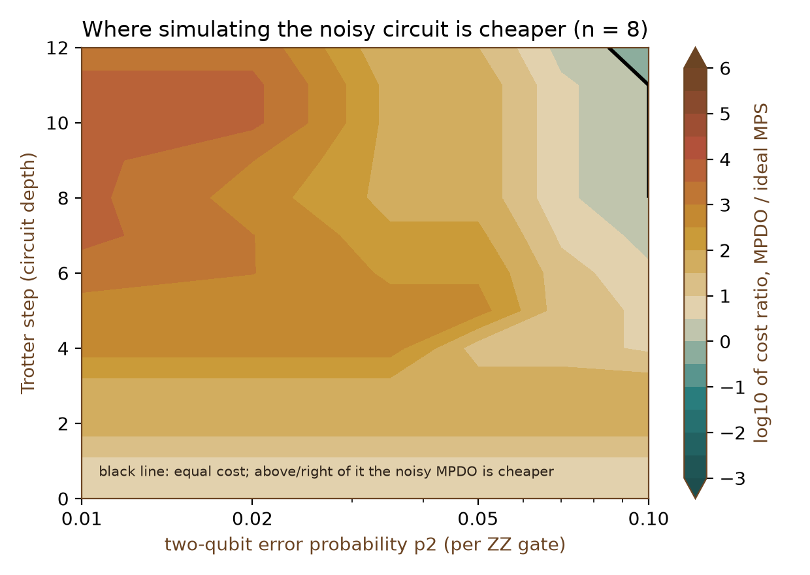
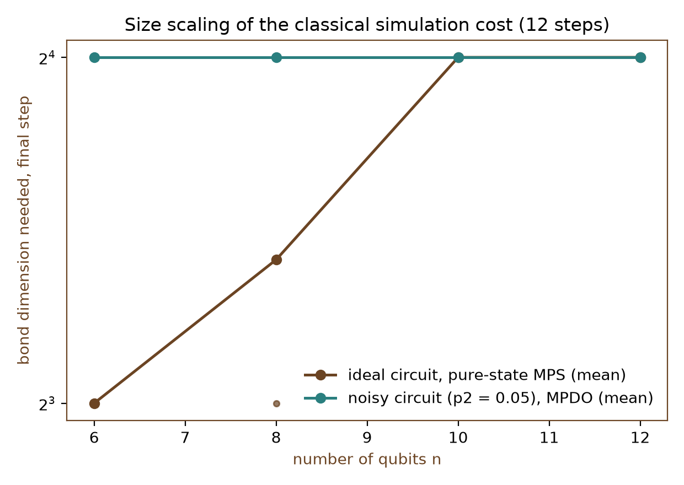
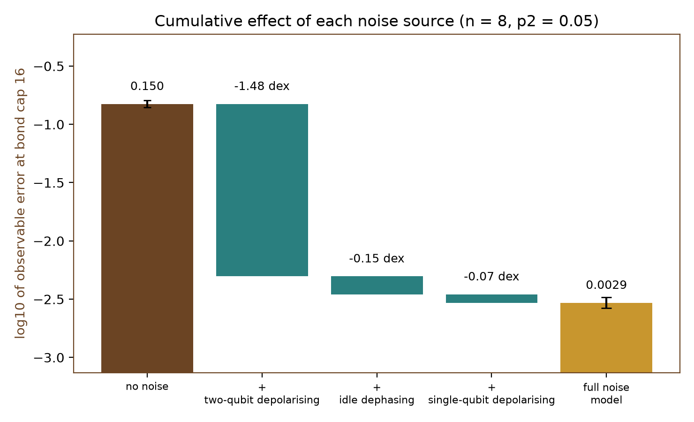
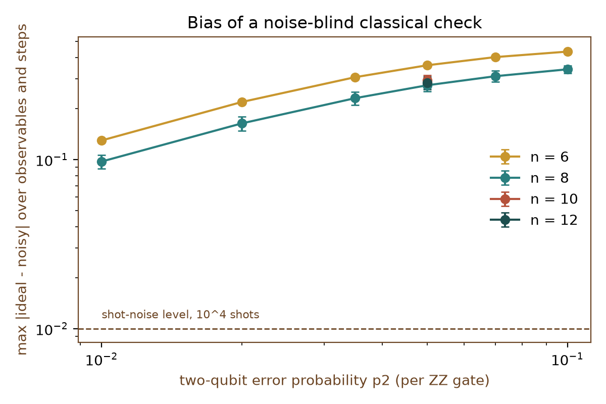

# Noise-Aware Matrix-Product Density-Operator Simulation of Noisy Trotter Quench Circuits

[](LICENSE)
[](pyproject.toml)
[](https://github.com/pradeepdegalaroyal/noise-aware-mpdo-bond-dimension-trotter-quench/actions/workflows/ci.yml)

**Research question.** At what two-qubit gate error does a noise-aware matrix-product density operator (MPDO) become a cheaper classical model of a noisy Trotterised Ising quench than the usual noiseless matrix-product state (MPS) of the ideal circuit?

**Answer in one line.** Only at very high error: for n = 8 qubits and 12 Trotter steps the MPDO is cheaper above a two-qubit error probability p2 of about 0.084, while at p2 = 0.01 it costs about 2.9 x 10^3 times more, and the noiseless MPS misses the noisy output by 0.097 +- 0.009, ten times the shot-noise level of 10^4 shots (simulation, 3 seeds).

## Abstract

We build a noise-aware MPDO engine (time-evolving block decimation, TEBD, on a vectorised density operator) and validate it against the Qiskit Aer density-matrix simulator to 1.6 x 10^-15. For a Trotterised mixed-field Ising chain of 6-12 qubits with gate-attached Pauli noise, we measure the bond dimension chi* each method needs to keep three local observables within 0.01 of the exact noisy answer, and we compare the per-update cost of the MPDO with that of the ideal-circuit MPS. The noise-aware model is not cheaper at error rates typical of current devices (break-even p2 about 0.084 for n = 8), two-qubit depolarising noise accounts for most of the saving when it does appear, and a noise-blind classical check is biased far beyond shot noise.

## Motivation

Landmark device experiments are judged against a classical cost: Arute et al. (2019) verified a 53-qubit sampling experiment by classical simulation, and Havlíček et al. (2019) argue that a quantum feature space is only efficiently accessible on a quantum computer. The review of Bauer et al. (2020) asks that regimes of possible advantage be identified carefully, and Bernien et al. (2017) supply the physical setting studied here, quench dynamics of an Ising-type spin model. In practice the classical cost is estimated for the ideal circuit, whereas a device runs a noisy one. This project quantifies how far that difference matters for a Trotterised quench at laptop scale.

## Research gap

The five papers provided for this study (three landmark papers and two reviews; no recent or adjacent entries were available) are summarised below. The full related-work table is in [`docs/RESEARCH_GAP.md`](docs/RESEARCH_GAP.md).

| Paper | Year | Role | Not covered |
|---|---|---|---|
| Arute et al., doi:10.1038/s41586-019-1666-5 | 2019 | landmark | Classical cost of a structured dynamics circuit as a function of gate error |
| Havlíček et al., doi:10.1038/s41586-019-0980-2 | 2019 | landmark | Noise-dependent classical-cost estimate of the circuits it runs |
| Bernien et al., doi:10.1038/nature24622 | 2017 | landmark | Digital emulation, noise accounting, bond-dimension cost |
| Bauer et al., doi:10.1021/acs.chemrev.9b00829 | 2020 | review | A quantitative simulability boundary for noisy dynamics circuits |
| Gaita-Ariño et al., doi:10.1038/s41557-019-0232-y | 2019 | review | Algorithm-level benchmarking against classical simulation |

## What is new here

- A fixed-tolerance, bond-dimension measurement of the classical cost of a *noisy* Trotter circuit, set against the ideal-circuit MPS cost on the same instances, with a cost-ratio phase diagram over gate error and depth.
- A cumulative noise-source ablation that separates two-qubit depolarising noise, idle dephasing and single-qubit depolarising noise.
- A scored comparison showing how far a noise-blind classical check lies from the noisy output, in units of shot noise.
- A Qiskit Aer cross-check and transpilation accounting (two controlled-NOT gates per ZZ rotation) tying the simulated noise parameters to a hardware reading.

## Hypotheses and outcome

Stated before the experiments (see [`docs/RESEARCH_GAP.md`](docs/RESEARCH_GAP.md)); the tolerance is 0.01 on the largest observable error.

| Hypothesis | Outcome |
|---|---|
| H1: break-even p2 <= 0.01 for n = 8 | **Falsified.** Break-even p2 is about 0.084 (interpolated between 0.07 and 0.1). |
| H2: chi* falls as p2^(-1) | **Falsified under the stated rule.** Fitted log-log slopes are -1.13 (n = 6) and -1.29 (n = 8); the seed spread is zero because chi* moves in factors of two, so grid resolution limits the comparison. |
| H3: MPDO chi* saturates with n while the ideal MPS needs 2^(n/2) | **Half supported.** The MPDO value is 16 for n = 6-12 at p2 = 0.05, but the ideal MPS also plateaus at 16 for n = 10 and 12 at this depth (below 2^(n/2) = 32 and 64). |

## Results

All numbers come from `results/final_step_table.csv`, `results/summary.json`, `results/ablation.csv` and `results/ideal_gap.csv`. Mean +- sample standard deviation over seeds 0-2; the seeds vary the calibration jitter of the circuit angles. Bond caps are powers of two, so chi* is quantised.

### Noise sweep (final step 12, tolerance 0.01)

Cost ratio = (4 chi*_MPDO)^3 / (2 chi*_MPS)^3, averaged over seeds; values below 1 mean the MPDO is cheaper. The ideal-circuit MPS needs chi* = 8.0 +- 0.0 (n = 6) and 10.7 +- 4.6 (n = 8).

| p2 | n = 6: chi* MPDO | n = 6: cost ratio | n = 8: chi* MPDO | n = 8: cost ratio |
|---|---|---|---|---|
| 0.01 | 64 +- 0 | 4096 | 64 +- 0 | 2901 |
| 0.02 | 32 +- 0 | 512 | 64 +- 0 | 2901 |
| 0.035 | 16 +- 0 | 64 | 16 +- 0 | 45 |
| 0.05 | 16 +- 0 | 64 | 16 +- 0 | 45 |
| 0.07 | 8 +- 0 | 8.0 | 6.7 +- 2.3 | 3.3 |
| 0.10 | 4 +- 0 | 1.0 | 4 +- 0 | 0.71 |



*Takeaway: the noise-aware bond dimension falls roughly as p2 to the power -1.1 to -1.3 between p2 = 0.01 and 0.1, but only reaches single digits near p2 = 0.1.*



*Takeaway: at n = 8 the noisy MPDO is cheaper only in the top-right corner (p2 = 0.1, from step 8 on); everywhere else the ideal MPS is cheaper by factors up to about 10^3.*

### Size scaling (p2 = 0.05, 12 steps, tolerance 0.01)

| n | ideal MPS chi* | MPDO chi* | cost ratio |
|---|---|---|---|
| 6 | 8.0 +- 0.0 | 16 +- 0 | 64 |
| 8 | 10.7 +- 4.6 | 16 +- 0 | 45 |
| 10 | 16 +- 0 | 16 +- 0 | 8.0 |
| 12 | 16 +- 0 | 16 +- 0 | 8.0 |



*Takeaway: the MPDO cost is flat in n while the ideal MPS cost rises and then flattens at this depth, so the cost ratio shrinks from 64 to 8 but has not reached 1 by n = 12.*

### Noise-source ablation (n = 8, p2 = 0.05, error at bond cap 16)

| Configuration | Error at cap 16 | Step (decades) | chi* |
|---|---|---|---|
| no noise | 0.150 +- 0.011 | | 64, 64, 256 (exact chi squared of the ideal MPS) |
| + two-qubit depolarising | 0.00504 +- 0.00107 | -1.48 | 16 +- 0 |
| + idle dephasing | 0.00349 +- 0.00034 | -0.15 | 16 +- 0 |
| + single-qubit depolarising | 0.00295 +- 0.00032 | -0.07 | 16 +- 0 |



*Takeaway: two-qubit depolarising noise removes about 1.5 decades of truncation error; idle dephasing and single-qubit noise add 0.15 and 0.07 decades. The noise ratios p1 = 0.1 p2 and pd = 0.2 p2 are assumptions, so the split is model-dependent.*

### Noise-blind classical check

Largest absolute difference between the ideal and the noisy observables over three observables and all steps (n = 8: 0.097 +- 0.009 at p2 = 0.01; 0.275 +- 0.023 at p2 = 0.05; 0.342 +- 0.019 at p2 = 0.1; n = 6: 0.130 +- 0.004 at p2 = 0.01).



*Takeaway: at p2 = 0.01 an ideal-circuit simulation, even with unlimited bond dimension, lies about ten shot-noise units (10^4 shots) away from the noisy output.*

### Looser tolerance (0.03)

The ordering persists but the gap narrows: for n = 8 the MPDO needs chi* = 4 for p2 >= 0.05 against 8 for the ideal MPS (cost ratio 1.0), and for n = 12 at p2 = 0.05 the ratio is 3.3 (`results/final_step_table.csv`).

### Validation

The exact simulator matches Qiskit Aer's density-matrix simulation with an equivalent noise model to a maximum absolute deviation of 1.6 x 10^-15 over three cases (`results/validation.json`). For n = 8, one Trotter step has 7 ZZ rotations and transpiles to 14 controlled-NOT gates on a line (depth 12), so p2 corresponds to roughly twice the per-controlled-NOT error.

## Method

```mermaid
%%{init: {'theme': 'base', 'themeVariables': {'primaryColor': '#ffffff', 'primaryTextColor': '#000000', 'primaryBorderColor': '#000000', 'lineColor': '#000000', 'secondaryColor': '#ffffff', 'tertiaryColor': '#ffffff', 'background': '#ffffff', 'noteBkgColor': '#ffffff', 'noteTextColor': '#000000', 'actorBkg': '#ffffff', 'actorBorder': '#000000', 'actorTextColor': '#000000', 'signalColor': '#000000', 'signalTextColor': '#000000', 'labelBoxBkgColor': '#ffffff', 'labelTextColor': '#000000', 'clusterBkg': '#ffffff', 'clusterBorder': '#000000'}}}%%
classDiagram
    class QuenchSpec {
        +int n
        +int steps
        +float dt
        +float jitter
        +int seed
        +angles()
        +neel_bits()
    }
    class NoiseSpec {
        +float p2
        +float p1
        +float pd
        +from_p2()
    }
    class MPS {
        +list tensors
        +int center
        +canonicalise()
        +apply_two()
        +expect_vec()
    }
    class Simulate {
        +run_exact()
        +run_ideal_mps()
        +run_mpdo()
    }
    class Trace {
        +array obs
        +array bond
    }
    class BondSearch {
        +search_caps()
        +chi_star_curve()
    }
    class QiskitCheck {
        +aer_observables()
        +transpiled_cx_count()
    }
    class Experiments {
        +stage_noise_sweep()
        +stage_ablation()
        +stage_size_scaling()
        +make_all()
    }
    QuenchSpec --> Simulate
    NoiseSpec --> Simulate
    Simulate --> MPS
    Simulate --> Trace
    BondSearch --> Simulate
    Experiments --> BondSearch
    Experiments --> QiskitCheck
```

*Legend: MPS = matrix-product state, also used as the vectorised density operator (MPDO, matrix-product density operator); angles() returns the jittered rotation angles; the bond cap and truncation live in `MPS.apply_two`; `transpiled_cx_count` counts controlled-NOT (CX) gates.*

**Circuit.** One Trotter step of a mixed-field Ising chain with open boundary: two-qubit ZZ rotations (RZZ) on even then odd bonds, then X and Z rotations on every qubit, with coupling J = 1, transverse field hx = 0.9045, longitudinal field hz = 0.809 and Trotter step dt = 0.4, starting from the Néel state |0101...>, with 10 % Gaussian jitter on the angles (seeded). The circuit is the target; Trotter error is outside the question.

**Noise.** Two-qubit depolarising error p2 after each ZZ rotation, single-qubit depolarising error p1 = 0.1 p2 after each rotation layer, and a Z-flip probability pd = 0.2 p2 per qubit per step.

**Simulators.** (i) Exact vectorised density operator (reference, n <= 10; for n = 12 an MPDO with cap 64 is the reference). (ii) Ideal-circuit MPS with truncated TEBD, the standard classical-cost yardstick. (iii) Noise-aware MPDO: gate and noise are fused into one 16 x 16 superoperator per bond, applied on a four-level-per-qubit MPS with two-norm truncation in canonical form. (iv) The plain noisy circuit is the standard quantum baseline: the output a device would give without mitigation.

**Metric.** chi* is the smallest bond cap in {2, 4, ...} for which every tracked observable (staggered magnetisation, nearest-neighbour ZZ correlator, mean X) stays within 0.01 (also 0.03) of the exact result at all steps up to the stated depth. The cost proxy for a two-site update is (d chi)^3 with d = 2 for the MPS and d = 4 for the MPDO. Details: [`docs/METHOD.md`](docs/METHOD.md).

## Discussion

The central result is negative. Within 6-12 qubits and 12 steps, treating the noise explicitly does not make the classical simulation of the noisy circuit cheaper than simulating the ideal circuit unless p2 is around 0.08 or larger. At p2 = 0.01 the density-operator bond dimension reaches the exact limit for n = 6 (64) and stays at 64 for n = 8, a cost ratio near 3 x 10^3. This is partly a size effect: the ideal MPS has little entanglement to carry at 12 steps, so its cost is small, and the ratio falls from 64 to 8 between n = 6 and 12 at p2 = 0.05. Whether it reaches 1 at larger n or depth is not established here.

Two secondary findings are more robust. First, the noise-blind ideal-circuit result is far from the noisy output (0.097 at p2 = 0.01), so an ideal-circuit check cannot validate a noisy device to shot-noise precision; the noise-aware model is needed for verification even when it is expensive. Second, in this model two-qubit depolarising noise supplies nearly all the benefit (1.48 of 1.70 decades).

Negative and ambiguous points: H1 and H2 are falsified under the pre-stated rules, H3 is only half supported, the bond-dimension measure is coarse (powers of two, zero spread across seeds at most points), and the n = 8, p2 = 0.07 entry has a large spread (6.7 +- 2.3) because one seed sits on a different grid step.

## Limitations

- Simulation only, 6-12 qubits, 12 Trotter steps, one model family; nothing here extrapolates to 50+ qubits or to a real device.
- Pauli noise only: no amplitude damping, crosstalk, leakage or readout error; the ratios p1/p2 and pd/p2 are assumptions.
- Bond caps are powers of two; error is not strictly monotone in the cap, and the break-even p2 is interpolated on a six-point grid.
- Three seeds; the seed varies only the angle jitter, so most chi* spreads are zero by construction.
- For n = 12 the reference is an MPDO with cap 64, not an exact density operator.
- The cost proxy (d chi)^3 ignores implementation constants, memory traffic and the trace drift of a truncated MPDO, which is removed by dividing by the trace.

## Future work

- Run the same circuit family on a superconducting processor through Qiskit Runtime, fit p2 from interleaved benchmarking, and compare the measured observables with the noise-aware MPDO at the fitted rate.
- Add error mitigation (zero-noise extrapolation, probabilistic error cancellation) and ask how mitigation, which amplifies effective noise, changes the classical cost of the circuits it needs.
- Test heavy-hex layouts and compiled depth, other classical methods (Pauli propagation, stabiliser-rank simulation) and larger n and depth on a graphics processing unit (GPU) to locate the true break-even in size.

Related work by the author: [qcnn-vs-string-order-spt-shot-budget](https://github.com/pradeepdegalaroyal/qcnn-vs-string-order-spt-shot-budget) (MPS truncation in a many-body classification study) and [commuting-qaoa-line-compiler-noise-budget](https://github.com/pradeepdegalaroyal/commuting-qaoa-line-compiler-noise-budget) (exact density-matrix noise on a line-connected device).

## Reproducibility

```bash
pip install -r requirements.txt && pip install -e .
pytest -q                               # 8 tests, a few seconds
python experiments/run_all.py --quick   # smoke run, about 20 seconds
python experiments/run_all.py           # full study, about 7 minutes
```

Hardware used: Windows 11 laptop, Python 3.11.9, 16 threads (6 used for linear algebra), no GPU needed. Pinned versions are in `requirements.txt` (numpy 2.2.6, scipy 1.17.1, pandas 2.3.3, matplotlib 3.11.1, qiskit 2.4.2, qiskit-aer 0.17.2). Total time inside the bond-cap searches was 169 s (`results/summary.json`). Individual stages can be run with `--stage sweep|size|ablation|validation|figures`.

## Project structure

```
src/noisy_mpdo/   circuits.py, noise.py, mps.py, observables.py, simulate.py, search.py, qiskit_check.py
experiments/      run_all.py, stages.py, plots.py
tests/            test_simulators.py
docs/             RESEARCH_GAP.md, METHOD.md
results/          chi_star_by_step.csv, cap_errors.csv, ideal_gap.csv, ablation.csv,
                  final_step_table.csv, summary.json, validation.json
figures/          five figures (200 dpi)
.github/workflows/ci.yml
```

## Citation

```bibtex
@software{degala2026noisempdo,
  author  = {Degala, Chenchupradeep},
  title   = {Noise-Aware Matrix-Product Density-Operator Simulation of Noisy Trotter Quench Circuits},
  year    = {2026},
  version = {0.1.0},
  url     = {https://github.com/pradeepdegalaroyal/noise-aware-mpdo-bond-dimension-trotter-quench},
  license = {MIT}
}
```

MIT license (`LICENSE`). Citation metadata is also provided in `CITATION.cff`.
